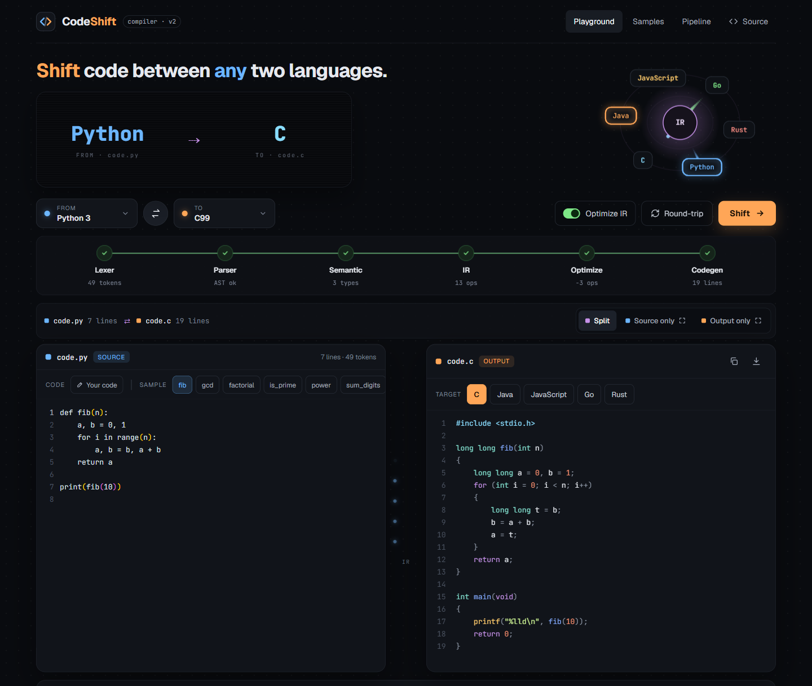
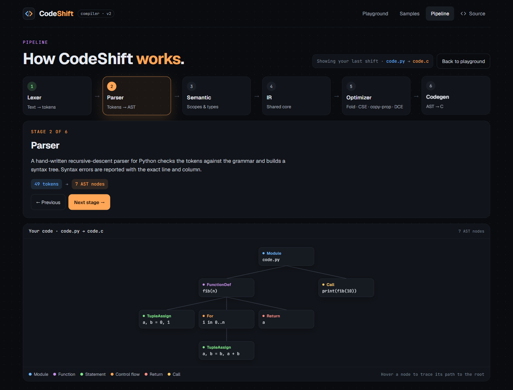
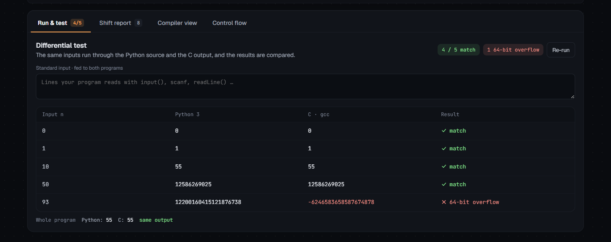
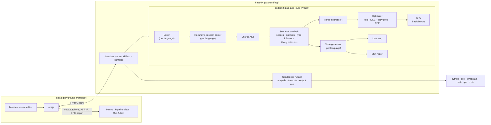

# CodeShift

CodeShift translates programs between **Python, C, Java, JavaScript, Go and Rust**, in all 30 directions. It is a real compiler pipeline, written by hand: a lexer and a recursive-descent parser for each language, one shared AST, semantic analysis with type inference, three-address IR, an optimizer, a control-flow graph, and a code generator for each language. A React playground shows every stage live and runs both programs to check that they print the same thing.


*Playground: the `fib` sample shifted from Python to C, with all six compiler stages complete.*


*Pipeline view, Parser stage: the AST the hand-written parser built from the code in the playground.*


*Run & test: both programs run on five inputs; C wraps at 64 bits where Python doesn't.*

## Architecture



How a translation flows, using `python → c` as the example:

| Stage | Module | What it produces |
|---|---|---|
| Lexing | `codeshift/frontends/python/lexer.py` | tokens `(kind, text, line, col)`, with `INDENT`/`DEDENT` for Python |
| Parsing | `codeshift/frontends/python/parser.py` | the shared AST (`codeshift/ast.py`); every node keeps its source line |
| Semantic analysis | `codeshift/semantic.py` | symbol table, inferred types (`n: int`, `fib → long long`), library calls resolved to intrinsics (`len(m)` on a dict → `@map_len`) |
| IR | `codeshift/ir.py` | three-address code: `t1 = n < 2`, `ifFalse t1 goto L1`, `t2 = call @sqrt, x`, … |
| Optimizer | `codeshift/optimize.py` | constant folding, dead-code elimination, copy propagation, CSE; every change is tagged for the UI |
| CFG | `codeshift/cfg.py` | basic blocks and true / false / back edges |
| Code generation | `codeshift/backends/c.py` | idiomatic C (`long long`, `%lld`, Allman braces), plus only the `cs_*` runtime helpers it needs |
| Line map / report | `codeshift/linemap.py`, `codeshift/report.py` | which source lines become which target lines; changed constructs, type notes, library mappings, approximation notes |

C-family frontends (C, Java, JS, Go, Rust) share a base parser in `codeshift/frontends/cfamily.py`, and each one raises its language's idioms (a C `for` loop, a Java `StringBuilder`, Go's `append`, Rust's `*m.entry(k).or_insert(0) += 1`) back into the same AST that Python produces. That shared AST is what makes all 30 directions work with 6 frontends and 6 backends, instead of 30 separate translators.

## What it supports

- **Core:** 64-bit integers, floats, booleans, characters, strings, functions with recursion, locals, compound and parallel assignment, swaps, `if`/`elif`/`else`, `while`, counted `for`, for-each, `break`/`continue`, one entry point per language.
- **Standard library:** math and conversions, string methods, typed dynamic lists and 2D grids, dicts and sets, `input()`, `print(..., end="")`, f-string formatting, `sys.exit`. Where a language has no built-in (C lists and maps, Java's `sorted`, Go's `csGetOr`, …), the backend emits a small helper, only when used, and every frontend recognises those helpers so the output translates back.
- **Honest differences:** the Shift report notes where languages really disagree: integer overflow (Python unbounded, C/Java/Go wrap, JS floats, Rust panics), the `%` sign rule, float and boolean printing, dict iteration order in Go and Rust, missing dict keys, rounding of exact halves.
- Anything else fails with `Unsupported: <construct> at line L, col C`; it never produces wrong code silently.

The 15 sample programs in [samples/](samples/) are written in all six languages; every direction must reproduce them byte for byte.

## Running it

Prerequisites (versions used during development):

| Tool | Version | Needed for |
|---|---|---|
| Python | 3.11+ (3.14 here) | backend, Python programs |
| Node.js | 18+ (24 here) | frontend, JavaScript programs |
| gcc | MinGW GCC 6.3 on Windows | C programs (`gcc -std=c99`) |
| JDK | 21 | Java programs |
| Go | 1.23+ (`slices.Sorted(maps.Keys(m))`) | Go programs |
| Rust | stable (on Windows the `stable-x86_64-pc-windows-gnu` toolchain) | Rust programs |

Only Python and Node are required to start the app; a missing compiler only makes Run & test report `missing toolchain` for that language.

**Windows, one step:** double-click `start.bat`. It creates `backend/.venv`, installs the packages, stops any old servers still holding ports 8000 and 5173, and opens the API (port 8000) and the site (port 5173) in two windows.

**By hand:**

```
cd backend
python -m venv .venv
.venv\Scripts\activate          (source .venv/bin/activate on Linux/macOS)
pip install -r requirements.txt
uvicorn app.main:app --reload --port 8000

cd frontend
npm install
npm run dev
```

The frontend reads the API address from `VITE_API_URL` (default `http://localhost:8000`).

## Deploying

- **Backend:** the root `Dockerfile` builds the API with all six toolchains. `render.yaml` deploys it as a free Render web service; Railway also builds it from the Dockerfile. Settings: `COMPILE_TIMEOUT`, `RUN_TIMEOUT` (seconds), `MAX_JOBS` (programs run at once), `CORS_ORIGINS` (extra allowed sites, comma-separated).
- **Frontend:** a static Vite build (root `frontend/`), e.g. on Vercel, with `VITE_API_URL` set to the backend address.

## Tests

```
cd backend
.venv\Scripts\activate
pytest -q
```

About 2,000 tests: every sample in every direction (output, line groups, IR, compile-and-run, differential tests), golden programs for each standard-library area run in all 30 directions (`backend/tests/golden/`, with hand-written versions in other languages for idioms the backends don't emit), the IR interpreter, error positions for every frontend, and the API. A full run takes about 5 minutes on a laptop. GitHub Actions (`.github/workflows/tests.yml`) runs the same suite on Linux and builds the frontend.

## API

```
GET  /health                              -> {status, version, toolchains}
GET  /samples                             -> [{id, name, tags, code: {lang: text}, desc, topics, inputs, stdin?}]
POST /translate {src, tgt, code, optimize} -> {output, srcLines, tgtLines, tokens, ast, symbols, ir, cfg,
                                               types, changed, approx, library, imports, stats, errors, works}
POST /run      {lang, code, inputs?}       -> {stdout, stderr, exitCode, timeMs, status}
POST /difftest {src, tgt, code, sample?, stdin?} -> {rows: 5 × {input, srcOut, tgtOut, match, reason},
                                                     label, program, errors}
```

User-code problems (syntax errors, unsupported constructs) come back as `errors: [{message, line, col, stage, side}]` with HTTP 200. `side` is `source` when the program itself is wrong or outside the subset, and `target` when only the chosen target can't express it; then `works` lists the other targets that translate it. Programs run in a fresh temporary directory under `backend/.cache` with a 5 s compile and 3 s run limit and a 64 KB output cap, never inside the API process.

## Repository layout

```
backend/
  app/            FastAPI app, routes, sandboxed runner, differential tests
  codeshift/      the compiler: tokens, ast, semantic, ir, cfg, optimize, linemap, report, pipeline, library
    frontends/    python, c, java, js, go, rust (lexer.py + parser.py each), cfamily.py, idioms.py
    backends/     python, c, java, js, go, rust; clists.py and cmaps.py hold the C runtime helpers
  scripts/        make_sample.py (builds a sample's other five files and its tests.json entry)
  tests/          pytest suite and golden programs
frontend/         React 18 + Vite playground, pipeline view and samples page
samples/          15 programs × 6 languages, tests.json, catalog.json
docs/             README screenshots and the social preview image
```
